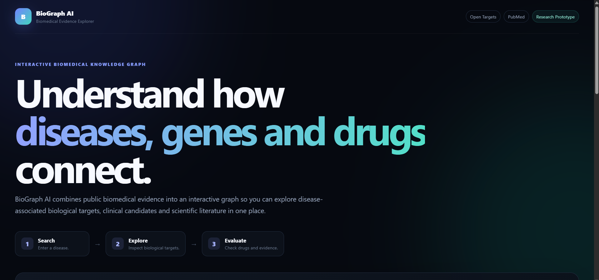
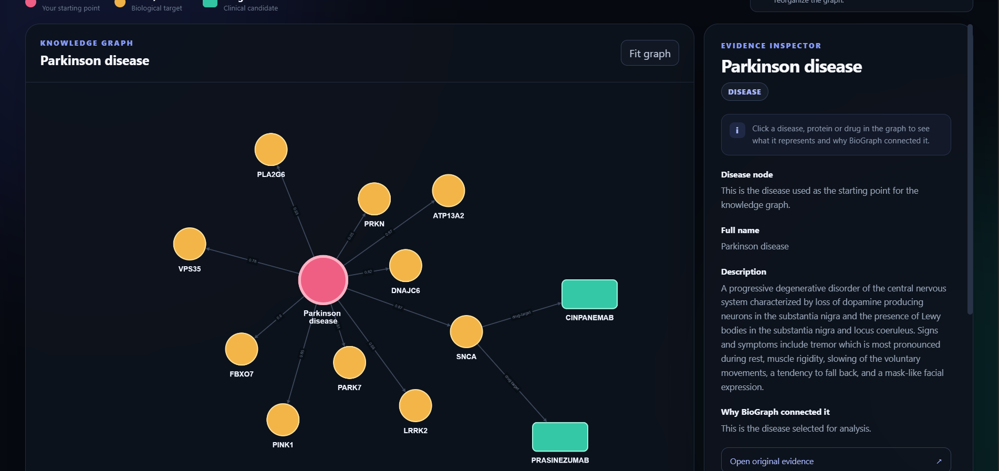
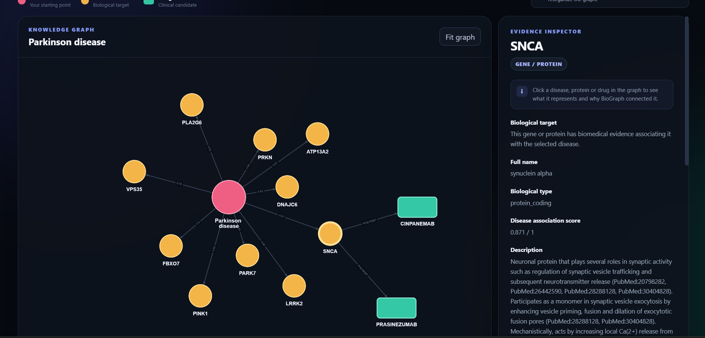
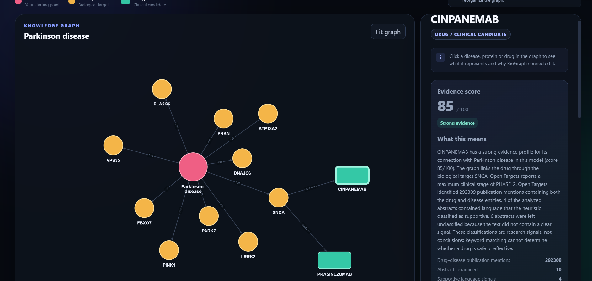

# BioGraph AI

**An evidence-aware biomedical knowledge graph for exploring disease → biological target → drug relationships.**

BioGraph AI is an interactive research prototype that combines public biomedical evidence from **Open Targets** and **PubMed** into a visual knowledge graph.

Instead of searching across separate databases, users can enter a disease and explore associated genes/proteins, drugs or clinical candidates, scientific literature, and an interpretable evidence score in one interface.

> **Research prototype only — not medical advice.**  
> BioGraph AI identifies evidence relationships; it does not prove that a drug is safe or effective for a disease.

---

## Demo



---

## Knowledge Graph

BioGraph represents biomedical relationships as:

**Disease → Gene / Protein → Drug / Clinical Candidate**



The graph is interactive. Clicking a node opens an evidence inspector containing descriptions, association information, source links, and scientific literature.

---

## Evidence Inspector

### Biological targets

Users can inspect why a gene or protein is associated with the selected disease.



### Drug evidence

Drug nodes include an evidence analysis combining biological, literature, and clinical signals.



---

## Why I Built BioGraph AI

Biomedical information is spread across many databases and publications. A researcher investigating a disease may need to separately search:

- disease-associated genes
- protein targets
- drug mechanisms
- clinical development information
- scientific literature

I wanted to test whether these signals could be combined into a single, understandable graph that lets a user move from a disease to its underlying biology and then inspect potential drug relationships.

BioGraph AI was built as both a software project and a research experiment.

---

## How It Works

When a disease is entered:

1. BioGraph searches Open Targets for the disease entity.
2. The strongest disease-associated biological targets are retrieved.
3. Drug and clinical-candidate data are collected for those targets.
4. Shared disease–target–drug relationships are added to the graph.
5. PubMed literature is retrieved for selected entities.
6. Drug nodes can be analyzed using an evidence-scoring system.
7. The user can inspect the underlying evidence and original sources.

---

## Evidence Scoring

BioGraph uses multiple evidence signals rather than presenting a drug–disease connection as automatically valid.

The system considers:

- biological target overlap
- target–disease association strength
- literature evidence
- supportive or uncertain language signals
- clinical-development stage
- clinical reports

Two scoring modes were evaluated during development.

### Full Evidence Model

Uses biological, literature, and clinical-development information.

### Prediction Model

Removes clinical-stage and clinical-report information and evaluates relationships using biological and literature evidence only.

The prediction version was created to test whether the system could distinguish known relationships without simply relying on existing clinical approval information.

---

## Benchmark

The final benchmark contained:

- **50 known therapeutic drug–disease relationships**
- **50 screened mismatched controls**

Controls were screened to remove pairs with:

- direct clinical-stage evidence
- clinical reports
- direct drug-target/disease-target overlap

### Final benchmark results

| Model | Known-pair mean | Control mean | Accuracy | Precision | Recall | F1 | ROC-AUC |
|---|---:|---:|---:|---:|---:|---:|---:|
| Full Evidence Model | 91.44 | 23.48 | 1.00 | 1.00 | 1.00 | 1.00 | 1.00 |
| Prediction Model | 58.76 | 23.48 | 1.00 | 1.00 | 1.00 | 1.00 | 1.00 |

These results mean that the selected known therapeutic pairs were completely separated from the screened controls **within this benchmark**.

They do **not** demonstrate 100% prospective drug-prediction accuracy.

---

## Important Limitations

BioGraph AI is an experimental research system.

The current evaluation has several limitations:

- the benchmark contains only 100 relationships
- screened controls are not experimentally proven therapeutic negatives
- the classification threshold was selected using the same benchmark used for evaluation
- literature classification currently uses simple transparent keyword heuristics
- publication co-occurrence does not establish causation
- biological plausibility does not establish treatment efficacy

A stronger future evaluation would use a completely independent held-out test set, failed clinical candidates, temporal validation, or prospective predictions.

---

## Data Sources

### Open Targets Platform

Used for:

- disease entities
- disease–target associations
- drug information
- mechanisms of action
- clinical candidates
- clinical-development evidence

### PubMed

Used to retrieve scientific publication metadata and abstracts for literature analysis.

---

## Technology

**Backend**

- Python
- FastAPI
- Requests
- GraphQL

**Frontend**

- HTML
- CSS
- JavaScript
- Cytoscape.js

**Research / Evaluation**

- Open Targets Platform API
- PubMed / NCBI E-utilities
- custom evidence-scoring system
- benchmark evaluation using accuracy, precision, recall, F1 and ROC-AUC

---

## Project Structure

```text
BioGraph-AI/
│
├── app/
│   ├── main.py
│   └── static/
│       ├── index.html
│       ├── app.js
│       └── styles.css
│
├── screenshots/
│   ├── homepage.png
│   ├── parkinson_graph.png
│   ├── protein_evidence.png
│   └── drug_evidence.png
│
├── benchmark.py
├── benchmark_final_results.csv
├── requirements.txt
└── README.md
```

---

## Run Locally

Clone the repository:

```bash
git clone YOUR_GITHUB_REPOSITORY_URL
cd BioGraph-AI
```

Create a virtual environment:

```bash
python -m venv .venv
```

### Windows

```bash
.venv\Scripts\activate
```

Install dependencies:

```bash
pip install -r requirements.txt
```

Start the application:

```bash
python -m uvicorn app.main:app --reload
```

Open:

```text
http://127.0.0.1:8000
```

---

## Research Direction

Future work includes:

- independent held-out validation
- failed-clinical-trial benchmarks
- temporal validation
- improved scientific-text classification
- evidence provenance at individual graph-edge level
- drug-repurposing hypothesis ranking
- larger disease and drug evaluation datasets

---

## Author

**Dharmik Tokala**

BioGraph AI was developed as an independent student project exploring the intersection of computer science, biomedical knowledge graphs, data analysis, and drug-discovery research.

---

## Disclaimer

BioGraph AI is intended for research and educational use only.

The system does not diagnose disease, recommend treatment, establish drug efficacy, or replace professional medical judgment.